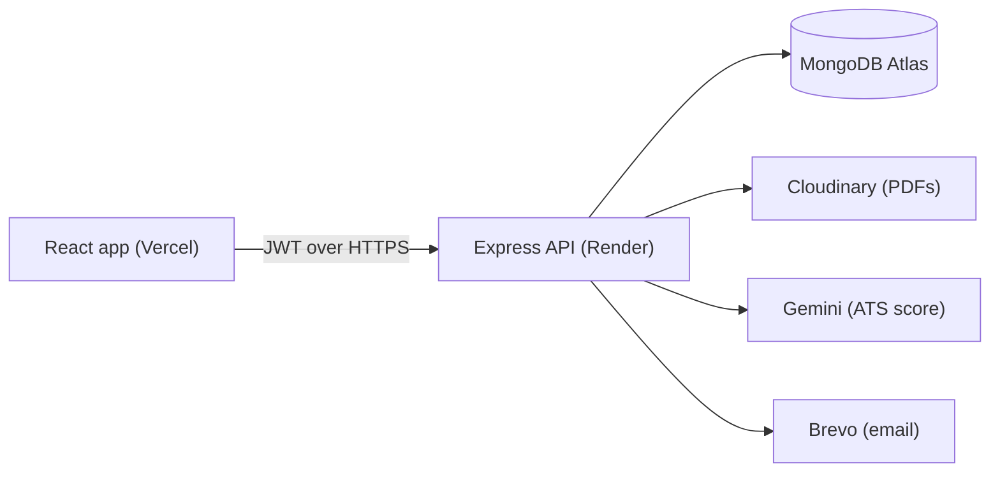

# JobVerse

A job portal I built with the MERN stack. Job seekers can search jobs, build a resume and check how well it matches a job description. Recruiters can post jobs and manage applicants.

**Live demo:** https://job-portal-rho-ruby.vercel.app

> It runs on free tiers, so the API sleeps when nobody's using it. If the first page load is slow, give it about a minute.

<!-- ASSUMPTION: rewrite this paragraph in your own words. -->
I wanted to build something complete rather than another to-do app: two kinds of users with different permissions, email sign-up, file uploads, an AI feature, and a real deployment. It ended up teaching me more about the unglamorous parts (permissions, dates, deploys) than I expected.


## What it does

- **Job seekers** search and filter jobs, save them, apply with a PDF or a resume built in the app, and track each application's status.
- **Resume builder** with a clean single-column template and PDF export.
- **ATS checker:** paste a job description (or pick a posted job) and get a 0–100 match score, matched and missing keywords, and suggestions. Scoring uses Google Gemini.
- **Recruiters** post jobs with deadlines, review applicants and update their status. Applicants get an email for every change.
- Email OTP for sign-up and password reset, dark/light theme, and it works on phones.

| | |
|---|---|
|  |  |

## Stack

React 19 + Vite on Vercel · Node/Express 5 + Mongoose on Render · MongoDB Atlas · Cloudinary for PDFs · Gemini for ATS scoring · Brevo for email · Jest, Supertest and Vitest for tests.



## A few decisions I'd point out

- **Expired jobs close when they're read, not on a timer.** Free-tier servers sleep, so a midnight cron might never run. Every job query first closes anything past its deadline.
- **Deadlines are calendar dates that end at midnight India time.** Comparing raw timestamps meant my laptop, Render (UTC) and a browser in New York all disagreed about when a job closed. Now both sides compare dates, and the tests run in three time zones.
- **Uploads are stored by content hash.** Applying to five jobs with the same PDF stores it once, and it's deleted only when no application uses it.
- **Reset links are single-use.** The reset token is signed with the user's current password hash, so it stops working once the password changes.
- **AI output is treated as untrusted.** The score is clamped, bad JSON gives a friendly "try again", and temporary Gemini errors are retried.

## Run it locally

The quickest way needs no accounts at all:

```bash
cd backend && npm install && npm run sandbox
```

```bash
cd frontend && npm install && npm run dev:sandbox
```

Open http://localhost:5173. The sandbox uses an in-memory database with demo data, prints emails (including OTPs) to the terminal, and fakes the AI score. Demo logins are in `backend/scripts/sandbox.js`.

To run it against real services, copy `backend/.env.example` and `frontend/.env.example` to `.env`, fill them in, and use `npm run dev` in each folder.

## Deploying

- **MongoDB Atlas:** free cluster, and allow `0.0.0.0/0` under Network Access (Render has no fixed IP). If the health check says the database is disconnected, the cluster has probably been paused for inactivity, so resume it.
- **Render:** create a Blueprint from this repo; [`render.yaml`](render.yaml) has the settings. Fill in the secrets, and set `CLIENT_URL` to the Vercel URL (plus `https://job-portal-*-<team>.vercel.app` if you want deployment links to work).
- **Vercel:** set the root directory to `frontend` and `VITE_API_URL` to the Render URL. [`vercel.json`](frontend/vercel.json) makes page refreshes work.

## What I'd improve next

- Move the login token from `localStorage` to an httpOnly cookie.
- Limit OTP attempts per account, not just per IP.
- Snapshot a resume when someone applies, so later edits don't change what the recruiter sees.
- Paginate job search in the database instead of in memory.
- Break up the larger page components and add a few end-to-end tests.
