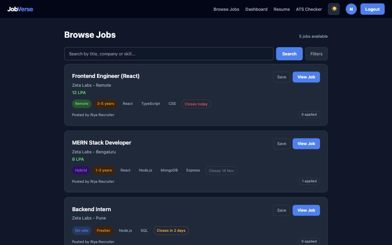
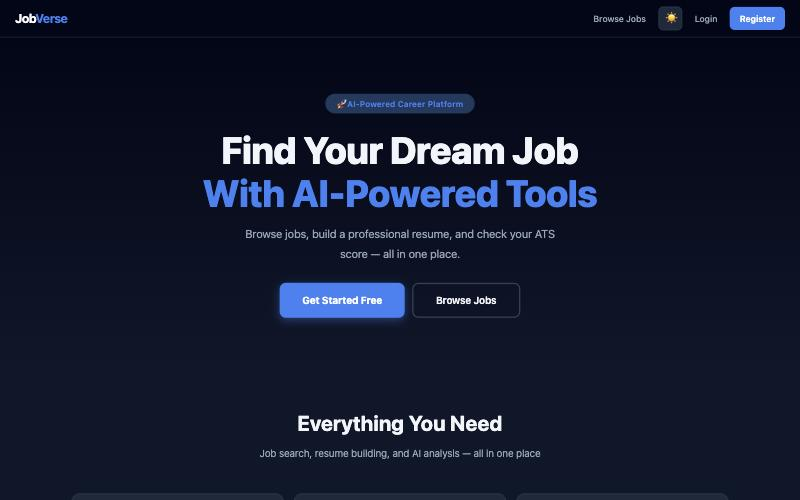
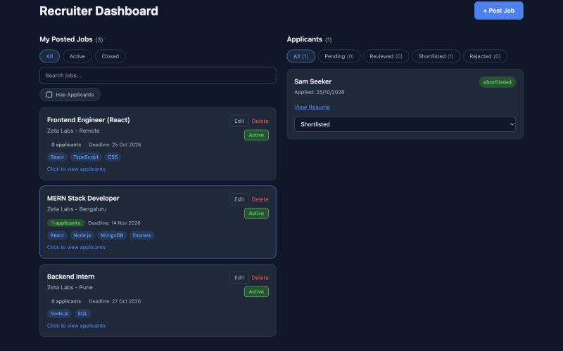
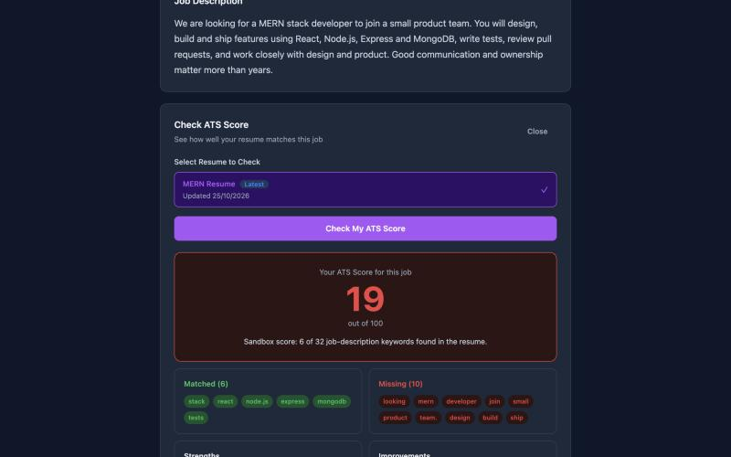
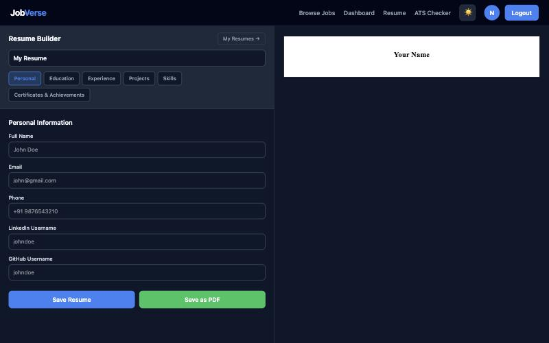
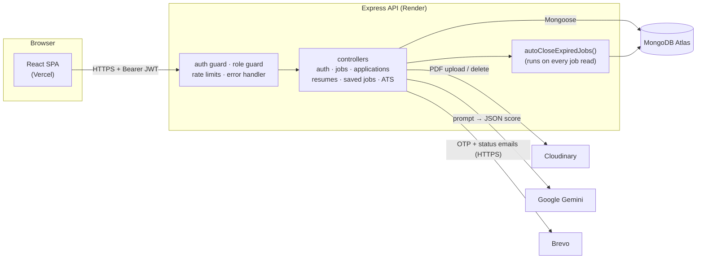

# JobVerse

A full-stack job portal where job seekers can find jobs, build a resume, and check how well that resume matches a job description, and where recruiters can post jobs and manage applicants.

**Live demo:** _coming soon_ · **API health:** _coming soon_

<!-- ASSUMPTION: the motivation paragraph below is a neutral placeholder. Rewrite it in your own words. -->
I built JobVerse to work through a complete product end to end: two kinds of users with different permissions, email-verified sign-up, file uploads, an AI feature that has to cope with unreliable output, and dates that have to mean the same thing on the server and in the browser. It is built with the MERN stack and deployed on free tiers.



## What it does

**For job seekers**
- Browse and search jobs by title, company or skill, and filter by location (with aliases like Bangalore/Bengaluru and Gurgaon/Gurugram), work type, experience and salary band.
- Save jobs, apply with an uploaded PDF or with a resume built inside the app, and track each application (pending, reviewed, shortlisted, rejected).
- Build resumes in a single-column template and export them to PDF.
- Run an **ATS check**: paste any job description, or check against a posted job, and get a 0–100 match score with matched and missing keywords, strengths and suggested improvements. Scoring uses Google Gemini, and every check is saved to a history.

**For recruiters**
- Post, edit, close and reopen jobs with an optional deadline. Jobs close automatically once the deadline day is over.
- See applicants per job, open their resumes, and update their status. The applicant gets an email for every status change.

**For everyone**
- Email OTP verification on sign-up and for password reset, light and dark themes, and a layout that works on phones.

| | |
|---|---|
|  |  |
|  |  |

_The ATS screenshot is from the local sandbox, which swaps Gemini for a simple keyword-overlap scorer (see [Running it locally](#running-it-locally))._

## Tech stack

| Layer | What I used |
|---|---|
| Frontend | React 19, React Router 7, Vite 8, Axios, `@react-pdf/renderer` |
| Backend | Node.js 22, Express 5, Mongoose 9, JSON Web Tokens, bcrypt, Multer, express-rate-limit |
| Data and services | MongoDB Atlas, Cloudinary (resume PDFs), Google Gemini (ATS scoring), Brevo or Gmail SMTP (email) |
| Testing | Jest, Supertest, mongodb-memory-server, Vitest, React Testing Library |
| Hosting | Vercel (frontend), Render (API), MongoDB Atlas free cluster |

## Architecture



The backend is split into `app.js`, which builds the Express app and is what the tests import, and `server.js`, which loads `.env`, connects to MongoDB and starts listening. Routes are thin. Controllers do the work, and shared rules (deadlines, error mapping, Cloudinary cleanup) live in `backend/utils`.

```
backend/   app.js · server.js · routes/ · controllers/ · models/ · middleware/ · utils/ · tests/ · scripts/sandbox.js
frontend/  src/pages/ · src/components/ · src/context/ · src/hooks/ · src/utils/ · src/__tests__/
```

## Design decisions

**Expired jobs close when they're read, not on a timer.** Render's free tier sleeps when idle, so a cron job might not be running at midnight. Every endpoint that reads jobs first runs one `updateMany` that closes anything past its deadline. It's cheap thanks to the `status` filter, and it means a job is never shown as open after its deadline, however long the server slept.

**A deadline is a calendar date, and it ends at midnight India time.** The date picker sends `2026-10-25`, which MongoDB stores as UTC midnight. Comparing that with "now" gave different answers depending on where the code ran: my laptop (IST) closed jobs at a different moment from Render (UTC), and a browser in New York showed the 15th as the 14th. Now the server and the frontend both compare *calendar dates*, with "today" taken in `Asia/Kolkata`, and display the stored date without converting it. The tests run the date logic under IST, UTC and New York time zones to keep it that way.

**Uploads are content-addressed.** A resume PDF's Cloudinary ID is a SHA-256 hash of its bytes, so applying to five jobs with the same file stores it once. When an application is withdrawn or a job is deleted, the file is removed only if no other application still points to it.

**Password-reset tokens are single-use.** The reset JWT is signed with the server secret *plus the user's current password hash*. Once the password changes, the token can no longer be verified, and it can never be used as a login token because it isn't signed with the session secret alone.

**The AI's output is treated as untrusted input.** Gemini is asked for JSON, but the response is still parsed defensively: the score is clamped to 0–100, lists are filtered to strings, and unreadable output becomes a clear "try again" message instead of a crash. Rate-limit and "model overloaded" errors are retried twice with backoff, since on the free tier they usually clear within a second.

**Email goes over HTTPS in production.** Render's free tier blocks outbound SMTP, so when `BREVO_API_KEY` is set, mail goes through Brevo's REST API. Locally, Gmail SMTP with an app password still works.

**One error shape for the whole API.** Controllers hand errors to a single `sendError` helper. Invalid IDs and failed schema validation become `400` responses with a readable message, deliberate errors keep their status, and anything unexpected is logged and returned as a generic `500` that doesn't leak internals.

## Running it locally

You need Node.js 20.19+ (22 recommended).

### Quickest: the sandbox (no accounts needed)

```bash
cd backend && npm install && npm run sandbox
```

```bash
cd frontend && npm install && npm run dev:sandbox
```

Open http://localhost:5173. The sandbox runs the real API against an in-memory MongoDB with demo data. Emails, including OTPs, are printed to the API terminal instead of being sent, uploads go to a temp folder, and the ATS check uses a local keyword scorer. Demo logins and their password are in `backend/scripts/sandbox.js`. Everything is thrown away when you stop it.

### With real services

1. Copy `backend/.env.example` to `backend/.env` and fill in MongoDB, a JWT secret, Cloudinary, Gemini and email settings.
2. Copy `frontend/.env.example` to `frontend/.env`.
3. Run each app:

```bash
cd backend && npm install && npm run dev
```

```bash
cd frontend && npm install && npm run dev
```

### Environment variables

| Backend | Purpose |
|---|---|
| `MONGO_URI` | MongoDB connection string |
| `JWT_SECRET` | Signs session and reset tokens |
| `CLIENT_URL` | Comma-separated origins allowed by CORS (unset allows any) |
| `APP_TIMEZONE` | When deadlines end (default `Asia/Kolkata`) |
| `BREVO_API_KEY`, `EMAIL_FROM` | HTTPS email via Brevo; `EMAIL_FROM` must be a verified sender |
| `EMAIL_USER`, `EMAIL_PASS` | Gmail SMTP fallback (app password) |
| `CLOUDINARY_NAME`, `CLOUDINARY_API_KEY`, `CLOUDINARY_API_SECRET` | Resume PDF storage |
| `GEMINI_API_KEY`, `GEMINI_MODEL` | ATS scoring (model has a default) |
| `PORT` | Defaults to 3000 |

| Frontend | Purpose |
|---|---|
| `VITE_API_URL` | API origin without `/api`, e.g. `https://jobverse-api.onrender.com` |

## Tests

```bash
cd backend && npm test             # 144 API tests
cd backend && npm run test:tz      # deadline tests again under IST and New York time zones
cd frontend && npm test            # 58 unit tests
cd frontend && npm run test:tz     # same, with the browser clock in New York
```

The backend tests go through the real HTTP layer with Supertest and the real sign-up flow: register, read the OTP from the captured email, verify, then use the token. They never touch real services. MongoDB is an in-memory server, nodemailer, Cloudinary and Gemini are mocked, and the test setup makes `dotenv.config()` throw, so a test can't accidentally load a real `.env`. Date-dependent tests freeze only `Date`, keeping real timers so the database driver still works, and cover month, quarter, year and leap-day boundaries.

What's covered: every auth path (including expired, forged and unsigned tokens and single-use reset tokens), CRUD for each module, ownership (one user can't read, change or delete another's data), validation and malformed IDs, search and filters, pagination maths, status counts, upload cleanup, AI retries and bad AI output, and both email transports. Backend coverage is about 94% of statements. The frontend tests cover the hooks, context providers, API client and the date and salary helpers.

## Deployment

The API runs on Render, the frontend on Vercel, and the database on a MongoDB Atlas free cluster.

**MongoDB Atlas.** Create a free cluster and a database user. Under *Network Access*, allow `0.0.0.0/0`: Render's free tier has no fixed outbound IP, so this is the only option, and access is still protected by the database user's password. Atlas pauses free clusters after long inactivity. If the API's health check reports the database as disconnected, resume the cluster in Atlas.

**Render (API).** Create a *Blueprint* from this repo and Render will read [`render.yaml`](render.yaml): root `backend`, `npm ci --omit=dev`, `npm start`, health check at `/api/health`. Fill in the secrets it asks for. Set `CLIENT_URL` to the Vercel URL once you have it. The free instance sleeps after about 15 minutes of inactivity, so the first request after that takes around a minute.

**Vercel (frontend).** Import the repo, set the root directory to `frontend` (Vercel detects Vite), and add `VITE_API_URL` pointing at the Render URL. [`frontend/vercel.json`](frontend/vercel.json) rewrites every path to `index.html` so refreshing a deep link like `/jobs/123` works.

## Known issues and next steps

- **Sessions live in `localStorage`.** It's simple, but any XSS bug could read the token. Moving to an httpOnly cookie with a short-lived access token and a refresh token would be safer.
- **OTP guessing is limited only by the per-IP rate limit** (10 auth requests per 15 minutes). A per-account attempt counter would be stronger.
- **Applying with a saved resume links to the live resume**, so editing it later changes what the recruiter sees. Snapshotting it at apply time would fix that.
- **Job search loads every match before paginating**, because the salary filter can be inferred from free-text salaries. That's fine at this scale but would need a stored, indexed salary band to grow. Applicant counts are also one query per job.
- **ATS scores come from an LLM**, so the same resume can score a few points differently between runs.
- **Page components are large single files with inline styles**, and only the hooks, contexts and helpers have unit tests. Splitting the pages up and adding a few end-to-end tests (Playwright) is next.
- **Cold starts on Render's free tier** make the first request after idling slow.
